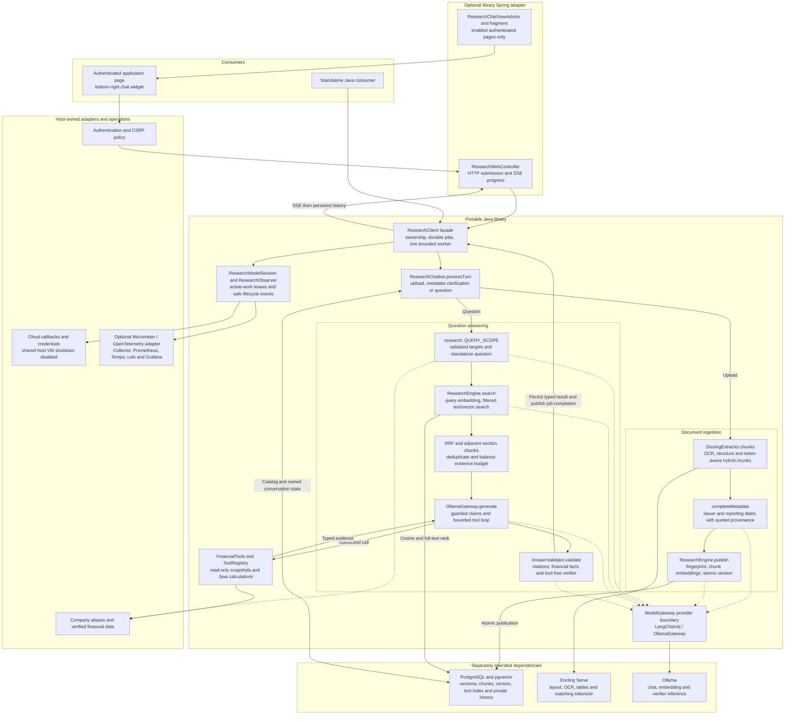
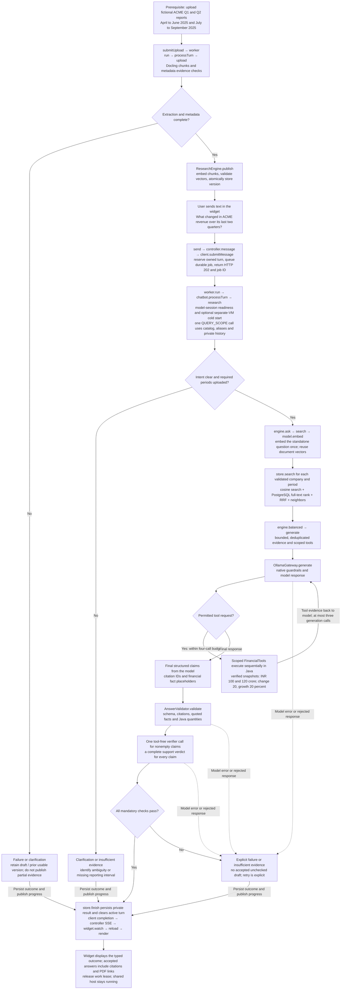

# DocRAG

Conversational document research for Java 21. Upload reports, ask questions naturally and inspect the sources behind
each answer. Use the plain Java client, add the Spring adapter, or embed the chat widget in an existing website.

- Structure-aware Docling chunks and persistent PostgreSQL/pgvector hybrid retrieval.
- Private conversations over a shared, authenticated document corpus.
- Scoped financial tools, Java calculations, citation checks and a tool-free claim verifier.
- Durable bounded jobs, cancellation, restart handling and optional Micrometer/OpenTelemetry integration.

[Architecture and module map](docs/ARCHITECTURE.md) · [Method flow](docs/MESSAGE-FLOW.md) · [Integration and operations](docs/OPERATIONS.md) ·
[Contributing](CONTRIBUTING.md) · [Security](SECURITY.md) · [Changelog](CHANGELOG.md)

## Quickstart: run the chatbot

These commands run **inside this repository**, independently of any parent application. Requirements: JDK 21,
Docker Compose, Node.js 24 for widget tests, and Ollama serving at `http://localhost:11434`.
The included Maven Wrapper downloads pinned Maven 3.9.11 on first use and verifies its SHA-256 checksum.
Builds resolve dependencies; model downloads and service startup are explicit.

1. Copy `.env.example` to `.env` (`Copy-Item .env.example .env` in PowerShell; `cp .env.example .env` on POSIX).
   Set its three password entries: the two database passwords must match;
   `DEMO_PASSWORD` is the browser login password. The launch scripts load `.env`; Java does not load it automatically.
2. Start PostgreSQL/pgvector and CPU Docling, and install the two Ollama models:

   ```sh
   docker compose up -d
   docker compose ps
   ollama pull qwen2.5:14b
   ollama pull embeddinggemma
   ```

   Wait for database health and Docling initialization. PostgreSQL binds `127.0.0.1:55432`, Docling `127.0.0.1:55001`.
   Model weights need substantial disk and RAM; benchmark against your hardware before increasing model size.
3. Build all modules and the complete example, then explicitly initialize a fresh research schema:

   PowerShell:

   ```powershell
   ./scripts/build.ps1
   ./scripts/run-example.ps1 -InitializeSchema
   ```

   POSIX shell:

   ```sh
   sh scripts/build.sh
   sh scripts/run-example.sh --research.initialize-schema=true
   ```

4. Open **http://localhost:8085**, sign in as **`demo`** using `DEMO_PASSWORD`, and open the bottom-right chat launcher.
   Upload a PDF, wait for `DOCUMENT_READY`, then ask a question. Use `run-example` without the setup flag on later
   starts.

For reproducible sample documents, generate fictional reports using the standalone commands below. Try:

- After uploading `ACME-Q2.pdf`: “What revenue did ACME report for the quarter ending September 2025?”
- Follow up in the same conversation: “What did it report about profit in that quarter?”
- After uploading `BRAVO-Q2.pdf`: “What revenue did ACME and BRAVO report in the quarter ending September 2025?”
- Without uploading Q3: “Compare ACME's three consecutive quarters ending December 2025.” This should request missing
  evidence.

The example's login is a local host implementation. Your application supplies its own authentication and verified
financial-data adapter. The example reads report facts; it does not fabricate financial snapshots for comparison tools.

## Storage setup and startup errors

Research is disabled by default in reusable host settings. Enabling it requires a compatible research schema in the
**same DataSource used by the host**. A database created for this example is separate from another application's
database.

For an existing Spring application, install the updated libraries, rebuild its JAR, and opt in once:

```sh
java -jar your-app.jar --research.enabled=true --research.initialize-schema=true
```

`research.initialize-schema` defaults to false. Explicit setup creates only missing research tables, indexes and
profile;
it validates an existing profile without recreating it. It never installs extensions, changes historical application
tables or replaces incompatible embeddings. An authorized database administrator must first enable pgvector >= 0.8:

```sql
CREATE
EXTENSION IF NOT EXISTS vector;
```

The extension must be visible on the DataSource search path. A model/dimension mismatch requires the original embedding
configuration or a separate schema and explicit re-ingestion. Changing only the generation model needs no re-embedding.
Connectivity/permission failures need database configuration fixes, not repeated initialization.

Read-only checks in the host database help distinguish missing prerequisites:

```sql
SELECT extversion
FROM pg_extension
WHERE extname = 'vector';
SELECT to_regclass('document_research.profile');
```

An absent extension returns no row; an absent profile returns null. Use your configured schema name in the second query.

## Installation from a clean checkout

Clone `https://github.com/mgoyal05/doc-rag.git` and run `./mvnw clean verify` (PowerShell: `./mvnw.cmd clean verify`).
One reactor builds the parent, core, four optional adapters and runnable example. `scripts/build` runs `install` when
local consumers need these artifacts. For core alone: `./mvnw -pl core -am clean install`; core requires no Spring.
Coordinates are `io.github.mgoyal05:doc-rag-<module>:0.1.0`; Java imports use `docrag.*`.
`core/` contains the portable API/engine; `docling/`, `widget/`, `observability/` and `spring-boot/` contain adapters.
`examples/spring-boot/` is the runnable host, and `postman/` contains local provider simulations.
These are prepared release coordinates. Until Maven Central publication is confirmed, build/install from source;
the dependency snippets below do not imply remote availability.

Plain Java consumer dependencies:

```xml

<dependencies>
    <dependency>
        <groupId>io.github.mgoyal05</groupId>
        <artifactId>doc-rag-core</artifactId>
        <version>0.1.0</version>
    </dependency>
    <dependency>
        <groupId>io.github.mgoyal05</groupId>
        <artifactId>doc-rag-docling</artifactId>
        <version>0.1.0</version>
    </dependency>
</dependencies>
```

Spring Boot 4 consumers use `io.github.mgoyal05:doc-rag-spring-boot:0.1.0`. This is an explicitly configured
adapter: register the client/properties and import `ResearchWebController` and `ResearchChatViewAdvice`. The complete
[Spring example](examples/spring-boot/src/main/java/example/DocRagApplication.java) shows every required bean,
authentication
and template. [Default example settings](examples/spring-boot/src/main/resources/application.properties) contain no
credentials.

## Example 1: plain Java upload and question

`ResearchClient` constructs storage, conversations, jobs, recovery and model coordination. Supply trusted identity,
a JDBC `DataSource`, a model gateway and an extractor. Provision storage explicitly before constructing a plain client.

```java
import docrag.*;
import docrag.docling.DoclingExtractor;
import org.postgresql.ds.PGSimpleDataSource;

import java.nio.file.Path;
import java.time.Duration;

public class ChatExample {
    static void main(String[] args) throws Exception {
        if (args.length != 1) throw new IllegalArgumentException("Usage: ChatExample report.pdf");
        var source = new PGSimpleDataSource();
        source.setUrl(System.getenv("RESEARCH_JDBC_URL"));
        source.setUser(System.getenv("RESEARCH_DB_USER"));
        source.setPassword(System.getenv("RESEARCH_DB_PASSWORD"));
        var model = new OllamaGateway("http://localhost:11434", "qwen2.5:14b", "embeddinggemma", Duration.ofMinutes(3));
        var extractor = new DoclingExtractor("http://localhost:55001", Duration.ofMinutes(5), "docling-serve-v1.30.0");
        var options = new ResearchClient.Options(Path.of("research-data"), "document_research", 768,
                Research.Settings.defaults(), 8, Duration.ofMinutes(30), Duration.ofSeconds(60), false);
        try (var client = ResearchClient.builder(source, model, extractor).options(options).build()) {
            String owner = "host-verified-user-id";
            String conversation = client.createConversation(owner).id();
            var upload = client.submitUpload(owner, conversation, Path.of(args[0]), "report.pdf");
            client.await(upload.id(), owner, Duration.ofMinutes(35));
            var result = client.history(owner, conversation).getLast().result();
            if (result == null || result.outcome() != ResearchChatbot.Outcome.DOCUMENT_READY) {
                System.out.println(result); // Continue any clarification in this conversation.
                return;
            }
            var question = client.submitMessage(owner, conversation, "What revenue does Acme report?");
            client.await(question.id(), owner, Duration.ofMinutes(35));
            System.out.println(client.history(owner, conversation));
        }
    }
}
```

Continue with `submitMessage(owner, conversation, "What did it say about profit in that quarter?")` for a follow-up.
History remains private and scope is resolved internally; callers do not need to supply company/year fields.
`submitUpload`/`submitMessage` return durable job IDs. Use `get`, `subscribe`, `cancel`, `retryTurn`, `history` and
`activeJob` on the same client. A completed job can answer, request clarification, report insufficient evidence or fail.
A timeout in `await` does not cancel the job. Run one instance per schema/job directory.

### Run the complete two-report example

Load the variables from `.env` into your process, then generate the runtime classpath:

```sh
./mvnw -pl docling -am org.apache.maven.plugins:maven-dependency-plugin:3.8.1:build-classpath -DincludeScope=runtime -Dmdep.outputFile=target/runtime-classpath.txt
```

PowerShell (use `./mvnw.cmd` for the classpath command above):

```powershell
Get-Content .env | ForEach-Object { if ($_ -match '^([A-Za-z_][A-Za-z0-9_]*)=(.*)$') { [Environment]::SetEnvironmentVariable($Matches[1], $Matches[2], 'Process') } }
$researchCp = (Resolve-Path docling/target/classes).Path + [IO.Path]::PathSeparator + (Get-Content docling/target/runtime-classpath.txt -Raw).Trim()
# Only for a fresh schema; skip if the Spring example already initialized this database/schema.
java -cp $researchCp docrag.example.DatabaseSettings initialize
java -cp $researchCp docrag.example.EvaluationFixtures research-demo
java -cp $researchCp docrag.example.CompanyResearchExample research-demo/reports/ACME-Q1.pdf research-demo/reports/ACME-Q2.pdf "What revenue does ACME report for the quarter ending September 2025?"
```

POSIX shell:

```sh
set -a; . ./.env; set +a
research_cp="docling/target/classes:$(cat docling/target/runtime-classpath.txt)"
# Skip initialization if this database/schema was already initialized by the Spring example.
java -cp "$research_cp" docrag.example.DatabaseSettings initialize
java -cp "$research_cp" docrag.example.EvaluationFixtures research-demo
java -cp "$research_cp" docrag.example.CompanyResearchExample research-demo/reports/ACME-Q1.pdf research-demo/reports/ACME-Q2.pdf "What revenue does ACME report for the quarter ending September 2025?"
```

[CompanyResearchExample.java](docling/src/main/java/docrag/example/CompanyResearchExample.java) is a public Java entry
point requiring no Spring. Fixtures generate ten fictional PDFs and fifty unreviewed question specifications, not a
reviewed model-accuracy benchmark. Close the website example before using the same job directory from another process.

## Example 2: embed the widget on a page

Serve the optional widget JAR resources and authenticated same-origin API, then mount:

```html

<script type="module">
    import {mount} from '/document-research/chat-widget.js';

    const chat = mount({apiBase: '/api/research', title: 'Report research'});
    // chat.open(); chat.close(); chat.setContext({documentIds: ['uploaded-id']}); chat.destroy();
</script>
```

The Spring example mounts the
shared [template fragment](spring-boot/src/main/resources/templates/fragments/research-chat.html).
The host derives user identity and supplies CSRF configuration. SSE carries progress/completion, and answers render as
safe text with expandable citations.
See [API routes and launcher diagnostics](docs/OPERATIONS.md#browser-widget-and-host-integration).

## Example 3: register financial tools

`FinancialTools` belongs to the core library. Its read-only adapter supplies sourced snapshots with dates, currency,
units and reporting basis. Register `ToolRegistry.financial(adapter)` on the client builder. Java computes supported
changes; incompatible or missing snapshots yield an explicit unavailable result. Additional trusted capabilities
implement `Research.Tool`; LangChain4j tool specifications are constructed inside the provider adapter, so public
types do not require
`@Tool`. [Tool contracts and limits](docs/OPERATIONS.md#tools-reusable-capabilities-host-adapters-and-tool).

## How RAG works

Uploads → Docling structure/token-aware hybrid chunks → Ollama document embeddings → atomic PostgreSQL publication.
Questions → owned conversation/history → validated scope and standalone question → query embedding → pgvector cosine
search + PostgreSQL full-text rank + RRF → scoped tools → generation → citation/fact checks + tool-free verifier →
result.

Document vectors live in `chunks.embedding vector(768)` and are reused across questions. Embedding text is separate
from original excerpts/page provenance. The default chunk budget is 512 tokens with heading context and compatible
merging; retrieval adds adjacent same-section chunks. Lucene, BM25 and a custom semantic/fixed-overlap chunker are not
used.
Missing periods, ambiguous metadata, partial extraction and failed validation produce explicit outcomes.
The [method guide](docs/MESSAGE-FLOW.md) maps every step to implemented methods and SQL.

## Repository layout

```text
pom.xml              Maven parent: versions, build rules and reactor modules
core/                portable Java API, engine, PostgreSQL store and Ollama gateway
docling/             optional official Docling Java adapter
spring-boot/         HTTP/SSE, properties, shared templates and loader
widget/              framework-independent Web Component
observability/       telemetry adapter and opt-in monitoring stack
examples/spring-boot/ complete authenticated application
scripts/             cross-platform build and launch commands
postman/             local synthetic dependency simulations
docs/                method flow, operations and rendered diagrams
.github/workflows/   standalone native PostgreSQL CI and dependency checks
```

The [module map](docs/ARCHITECTURE.md) shows dependency direction, runtime ownership and where to make changes.

## Complete architecture

[Open the rendered architecture at full size](docs/architecture.svg).



Glossary for this architecture and worked flow:

- **Standalone question / query rewriting:** a self-contained version of the current user question resolving omitted
  subjects and metrics from private history. It is produced by the existing scope-planning call, not by another model
  request; it is context for retrieval, not new evidence. **QUERY_SCOPE:** the internal structured planning operation.

- **Guardrail / fail closed / verifier:** an input or output validation hook; withhold an answer when mandatory checks
  fail;
  a separate tool-free model invocation checking each claim against its cited evidence. A verifier is fallible and is
  not independent human review.
- **Micrometer / OpenTelemetry / Collector / OTLP:** Java metrics instrumentation; vendor-neutral telemetry APIs; a
  telemetry receiving/processing service;
  OpenTelemetry Protocol. **Trace / span / metric / structured log:** a correlated operation path; one timed operation;
  a numerical measurement;
  an operational event with allowlisted fields. **Prometheus / Tempo / Loki / Grafana:** metric storage; trace storage;
  log storage; dashboards.
- **Quantization / MoE / CPU / RAM / RSS:** reduced-precision model weights; mixture of experts (only some model
  components activate per token);
  central processing unit; random-access memory; resident set size (actual process memory). Model download size is not
  peak RSS.

- **Facade / callback:** one public integration entry point hiding internal components; a host-supplied operation
  invoked by the library.

- **AI / RAG / LLM:** artificial intelligence; retrieval-augmented generation (retrieve evidence before generating);
  large language model (generates text/tool requests, which require validation).
- **API / HTTP / CSRF / SSE:** application programming interface; Hypertext Transfer Protocol; cross-site request
  forgery
  protection; server-sent events (one-way browser progress connection).
- **Java / Spring Boot / Web Component:** programming language/runtime; host application framework;
  framework-independent
  browser custom element. **SDK / JAR:** software development kit; Java archive containing classes/resources.
- **PDF / OCR / Docling:** Portable Document Format; optical character recognition of scans; structured document
  conversion
  and chunking toolkit. **PDFBox:** Java text-PDF processing library used explicitly and for evaluation fixtures.
- **Chunk / token / tokenizer / heading:** evidence fragment; model text unit; matching text-to-token encoder; document
  section title. **Hybrid chunking:** structure-aware segmentation refined to a token budget and merged when compatible.
- **Embedding / embedding profile:** numerical meaning representation; model identity, vector dimensions and processing
  settings determining compatibility. **Ollama / LangChain4j / ModelGateway:** model server; Java model-integration
  library;
  this project's provider abstraction.
- **PostgreSQL / JDBC / DataSource / pgvector:** relational database; Java Database Connectivity; host-supplied
  connection
  factory; PostgreSQL extension storing and searching vectors. **Schema / DDL:** database namespace; data definition
  language.
- **Full-text search / BM25 / vector search / cosine similarity:** lexical matching of normalized words; a lexical
  ranking
  algorithm **not used by this implementation**; nearest-embedding retrieval; directional similarity between vectors.
- **GIN / HNSW / RRF:** generalized inverted index for lexical queries; hierarchical navigable small world vector index;
  reciprocal rank fusion, combining ranked result lists using rank positions rather than incomparable raw scores.
- **Metadata / scope / reporting basis:** company/dates/source attributes; validated companies and reporting intervals
  for
  a question; whether financial figures are consolidated or standalone and otherwise comparable.
- **Citation / excerpt / provenance:** reference from a claim to evidence; retained original source text; traceable
  source
  document, pages, headings, extraction version and processing/model identity.
- **Fingerprint / idempotency / atomic publication:** content-and-processing hash; unchanged submissions avoid repeated
  processing; complete new evidence becomes visible together or previous evidence stays usable.
- **Tool / SPI / registry / adapter:** bounded read-only capability; service provider interface implemented by
  contributors;
  explicit capability catalog with selection; host mapping from its data into portable types.
- **Context budget / deduplication:** maximum evidence/history supplied to a model; removing repeated chunk IDs.
- **VM / work lease / idle grace / cold start:** virtual machine; active-job pin preventing shutdown; delay before
  stopping
  idle owned infrastructure; waiting for a stopped model machine to start and become ready.
- **Job / cancellation / recovery / observability / Micrometer:** durable processing request; stopping and rejecting
  stale
  completion; marking interrupted work after restart; measurable operational behavior; host metrics library.
- **QIP:** qualified institutional placement, a possible future financial-event tool domain.

## Worked user flow (illustrative)

[Open the rendered user flow at full size](docs/user-flow.svg).

Acme is fictional. Its reporting dates and numbers below explain the flow; they are not investment analysis.



## Verification and limitations

Run `scripts/build` with `-o` after dependencies are cached. Isolated PostgreSQL/pgvector tests require explicit
`RESEARCH_TEST_*` variables; otherwise those tests skip. Repository CI provisions native PostgreSQL. Widget checks run
from `widget/` with `npm ci --ignore-scripts`, `npx puppeteer browsers install chrome` and `npm test`.
See [commands and observed evidence](docs/OPERATIONS.md#verification-evaluation-and-adoption-limits).

Defaults bound one worker, eight queued jobs, two pending jobs per owner, two companies/four periods per question and
200 uploaded reports. Run one application instance per research schema/job directory. Real-model quality, OCR tables,
native concurrency and resource contention require workload-specific evaluation; a verifier is not proof of accuracy.

## License

[Apache License 2.0](LICENSE). See [NOTICE](NOTICE) and [third-party notices](THIRD_PARTY_NOTICES.md).
Model weights, source documents and dependencies retain their own licenses.

Release preparation, signed local bundles and outstanding verification gates are documented in
[operations](docs/OPERATIONS.md#release-preparation).
